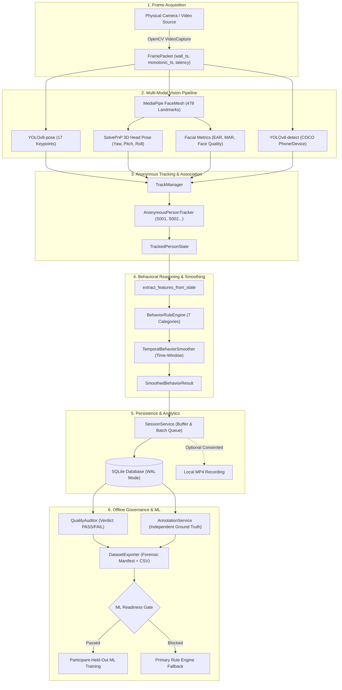
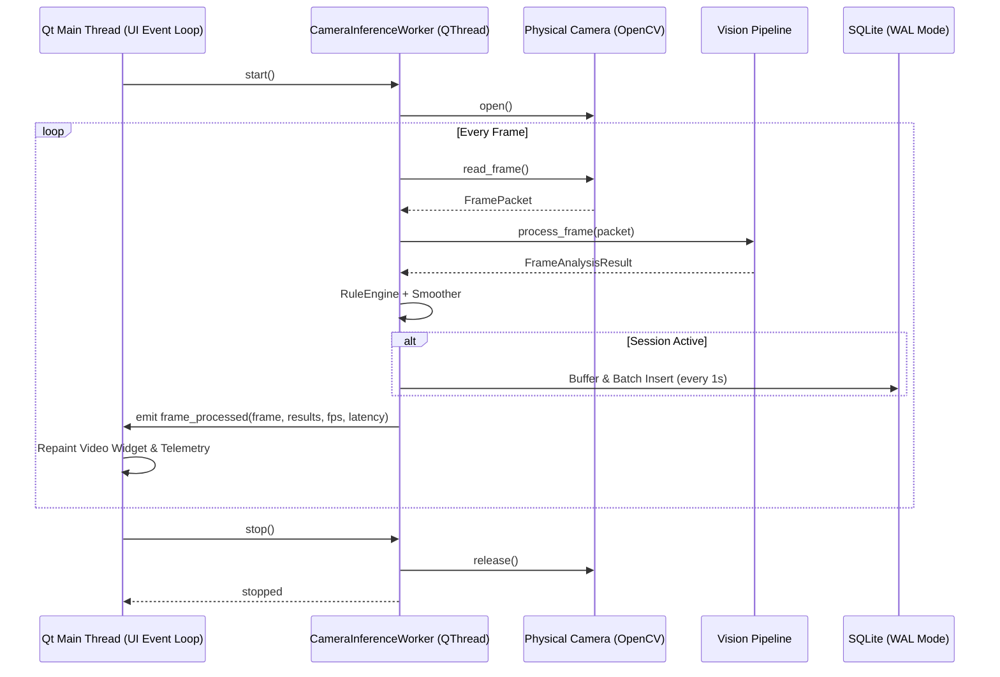

# System Architecture & Technical Specifications

**Lecture Engagement Pattern Analyzer**  
*(Classroom Behavioral Observation and Analysis System)*

---

## 1. High-Level Architecture Overview

The system is organized into modular, strictly decoupled layers. Computer-vision inference, behavioral classification, database storage, and the graphical user interface operate through clean interfaces and asynchronous worker threads to ensure continuous real-time execution without UI blocking.

---

## 2. Component Breakdown

### 2.1 Vision Layer (`src/lecture_analyzer/vision/`)
- **`camera.py` (`CameraService`)**: Discovers and opens camera indices via DirectShow (`cv2.CAP_DSHOW`) or Media Foundation. Measures precise acquisition latency using high-resolution monotonic timestamps (`time.perf_counter()`). Detects read failures and handles automatic reconnection without fabricating frame intervals.
- **`head_pose.py` (`HeadPoseEstimator`)**: Maps 6 canonical 3D facial landmark points (nose tip, chin, eye outer corners, mouth corners) to 2D image coordinates using `cv2.solvePnP` and `cv2.RQDecomp3x3`. Decomposes the rotation matrix into Euler angles (Yaw, Pitch, Roll in degrees). Rejects non-finite inputs and degenerate scales (< 5px eye distance).
- **`face_features.py` (`FaceFeatureExtractor`)**: Invokes Google MediaPipe FaceLandmarker task runner. Computes Eye Aspect Ratio (EAR) for both eyes, Mouth Aspect Ratio (MAR), and composite Face Quality (sharpness via Laplacian variance + face-to-frame area ratio).
- **`person_pose.py` (`PersonPoseEstimator`)**: Executes YOLOv8n-pose to detect human bounding boxes and 17 COCO keypoints. Computes shoulder tilt angle, torso uprightness ratio, head-to-shoulder offset, and wrist elevation.
- **`object_detection.py` (`ObjectDetector`)**: Uses YOLOv8n to identify cell phones (COCO class 67), laptops, and books. Evaluates spatial proximity and overlap between detected objects and person bounding boxes.
- **`observability.py`**: Evaluates sensory integrity and classifies observability into `FULL`, `PARTIAL_FACE_ONLY`, `PARTIAL_POSE_ONLY`, or `UNOBSERVABLE`.
- **`pipeline.py` (`VisionPipeline`)**: Orchestrates all perception modules and binds outputs to active tracks.

### 2.2 Anonymous Tracking Layer (`src/lecture_analyzer/tracking/`)
- **`tracker.py` (`AnonymousPersonTracker`)**: IoU-based bounding box tracking assigning session-local IDs (`S001`, `S002`, ...). Includes a configurable track retention grace period (default 2.5s) to bridge brief occlusions.
- **`track_manager.py` (`TrackManager`)**: Performs conservative geometric matching between detected faces, human poses, and detected phones. Ensures facial features from one person are never assigned to another.
- **Privacy Assurance**: No facial embeddings, biometric features, or cross-session identity vectors are ever computed or stored.

### 2.3 Behavioral Analysis Layer (`src/lecture_analyzer/behavior/`)
- **`labels.py`**: Defines the seven observable categories: `ENGAGED_BEHAVIOR`, `LOOKING_AWAY`, `HEAD_DOWN`, `PHONE_USE`, `WRITING_READING`, `DROWSY_SLEEP_LIKE`, and `UNCERTAIN`.
- **`rules.py` (`BehaviorRuleEngine`)**: A deterministic priority-based rule system:
  1. *Observability Gate*: If unobservable, outputs `UNCERTAIN`.
  2. *Phone Presence*: If phone detected with high confidence in interaction zone, outputs `PHONE_USE`.
  3. *Eye Closure*: If EAR < threshold (0.20), outputs `DROWSY_SLEEP_LIKE`.
  4. *Looking Away*: If |yaw| > threshold (28°), outputs `LOOKING_AWAY`.
  5. *Downward Pitch*: If pitch < -18°, checks wrist posture; if wrists at desk, outputs `WRITING_READING`, else `HEAD_DOWN`.
  6. *Forward Posture*: If yaw and pitch within forward ranges and eyes open, outputs `ENGAGED_BEHAVIOR`.
  7. *Fallback*: If evidence is partial or ambiguous, outputs `UNCERTAIN`. Never defaults to `ENGAGED_BEHAVIOR`.
- **`temporal_smoothing.py` (`TemporalBehaviorSmoother`)**: Wall-clock elapsed time sliding window (default 1.5s). Suppresses transient single-frame flicker while preserving raw frame states for auditability. Automatically wipes history if an observation gap exceeds 2.0s.

### 2.4 Storage Layer (`src/lecture_analyzer/storage/`)
- **`database.py` (`Database`)**: SQLite manager running Write-Ahead Logging (`PRAGMA journal_mode = WAL`) and foreign key enforcement (`PRAGMA foreign_keys = ON`).
- **`schema.py` & `migrations.py`**: Clean, versioned schema tracking sessions, tracks, observations, human annotations, quality reports, exports, and ML evaluations.
- **`repositories.py`**: High-throughput batch insertion for observations and cascading foreign-key deletion.

### 2.5 Collection & Protocol Layer (`src/lecture_analyzer/collection/`)
- **`consent.py`**: Enforces research collection gating: verifies explicit consent checkbox, participant code formatting, and live camera status.
- **`recording_service.py`**: Optional OpenCV `VideoWriter` capturing local `.mp4` video with disk space checks (requires >= 500 MB free space).
- **`session_service.py`**: Coordinates session lifecycle, in-memory buffering, and periodic incremental flushing to SQLite.

### 2.6 Annotation & Quality Layer (`src/lecture_analyzer/annotation/`, `src/lecture_analyzer/dataset/`)
- **`annotation_service.py`**: Manages human ground-truth intervals independently from system predictions.
- **`annotation_validation.py`**: Detects invalid boundaries, overlapping intervals, and calculates temporal coverage.
- **`quality_audit.py` (`QualityAuditor`)**: Evaluates inter-observation timing jitter, face quality, annotation coverage, and system-annotation descriptive agreement. Assigns verdicts: `PASS`, `PASS_WITH_WARNINGS`, `REVIEW_REQUIRED`, `FAIL`.
- **`export_dataset.py` (`DatasetExporter`)**: Exports CSV feature tables and comprehensive JSON metadata manifests with SHA256 checksums.

### 2.7 Machine Learning Layer (`src/lecture_analyzer/ml/`)
- **`readiness.py` (`MLReadinessChecker`)**: Gating engine verifying >= 10 distinct participants, >= 10 sessions, >= 600s annotation, class support, and strict `REAL_HUMAN` provenance.
- **`features.py`**: Standardized scikit-learn preprocessing pipeline using `ColumnTransformer`, `StandardScaler`, and `SimpleImputer`.
- **`evaluate.py`**: `GroupKFold` cross-validation grouped strictly by participant ID to guarantee zero subject leakage. Side-by-side benchmark against the rule engine.
- **`train.py`**: Baseline training for Random Forest, Logistic Regression, Decision Tree, and Majority Class.
- **`inference.py`**: Guarded runtime inference with automatic fallback to the rule engine if no validated model exists.

### 2.8 Desktop UI Layer (`src/lecture_analyzer/ui/`)
- Built with **PySide6**. Uses `QThread` workers (`CameraInferenceWorker`) to decouple 30 FPS computer-vision inference from the UI event loop. Custom painting widgets render low-latency video overlays.

---

## 3. Threading & Concurrency Model

