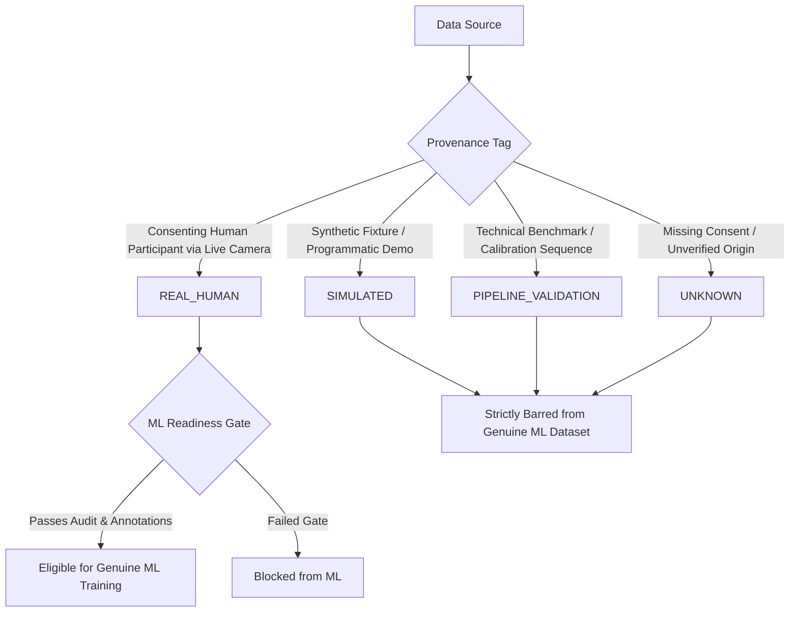

# Data Provenance & Governance Framework

**Lecture Engagement Pattern Analyzer**  
*(Classroom Behavioral Observation and Analysis System)*

---

## 1. Provenance Classifications

To maintain scientific integrity, ensure reproducibility, and prevent synthetic contamination of genuine research findings, all data recorded by or imported into the system is tagged with one of four mandatory provenance designations:

### 1.1 `REAL_HUMAN`
- **Definition**: Data collected from a consenting, physical human participant using an active, live physical webcam or a formally verified naturalistic recording.
- **Prerequisites for Attribution**:
  1. An anonymous alphanumeric participant identifier (e.g., `P001`, `P002`).
  2. Explicit confirmation of participant informed consent.
  3. Live camera verified as the direct input source.
- **ML Eligibility**: **Eligible** for inclusion in genuine research ML datasets *only* after passing a data quality audit and receiving independent human ground-truth annotations.

### 1.2 `SIMULATED`
- **Definition**: Observations generated programmatically, synthesized via test fixtures, or produced by automated script generators.
- **Intended Use**: Testing UI responsiveness, verifying database migrations, stress-testing batch insertion queues, and demonstrating dashboard features without requiring human participation.
- **ML Eligibility**: **STRICTLY DISALLOWED** from entering genuine human ML training or evaluation partitions.

### 1.3 `PIPELINE_VALIDATION`
- **Definition**: Controlled calibration sequences or technical test frames used to evaluate vision component accuracy (e.g., checking that solvePnP correctly returns a negative pitch when viewing a calibrated tilted head model).
- **ML Eligibility**: **Excluded** from general human ML datasets by default.

### 1.4 `UNKNOWN`
- **Definition**: Any recording, video file, or database record lacking verifiable provenance metadata, missing consent confirmation, or originating from an undocumented source.
- **ML Eligibility**: **STRICTLY DISALLOWED** from genuine research ML.

---

## 2. Provenance Gating & Export Enforcement

The dataset export subsystem (`src/lecture_analyzer/dataset/export_dataset.py`) enforces strict provenance barriers:

1. **Conservative Default**: The default export filter selects *only* `REAL_HUMAN` records.
2. **Exclusion of Non-Human Data**: Any session tagged as `SIMULATED`, `PIPELINE_VALIDATION`, or `UNKNOWN` is automatically filtered out and recorded in the manifest's `excluded_sessions` dictionary with the exact reason.
3. **Forensic Manifests**: Every export produces a cryptographically hashed JSON manifest recording:
   - Export ID and UTC timestamp
   - Total rows, session count, and participant count
   - SHA-256 checksum of the exported CSV
   - List of included and excluded sessions
   - Label distribution and missing-feature percentages

---

## 3. Privacy & Anti-Surveillance Safeguards

- **No Biometric Embeddings**: The system does not compute, extract, or store face embeddings (e.g., FaceNet, dlib 128D, ArcFace). It cannot re-identify participants across sessions.
- **Session-Local Tracking**: Tracking IDs (`S001`, `S002`, ...) are transient integer counters reset at each session start.
- **Local Storage Only**: All records and optional videos reside strictly on the local machine in `data/database/` and `data/recordings/`. No data is uploaded to cloud endpoints.
- **Right to Erasure**: Operators can permanently delete sessions and cascading observations through the GUI or database repository.
